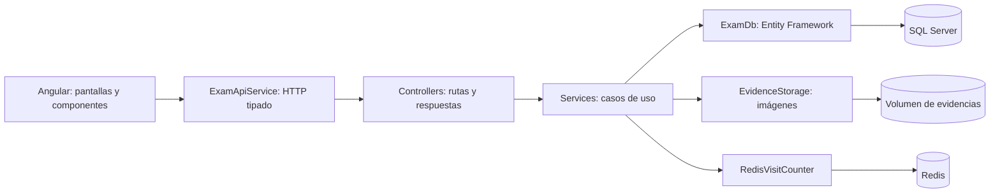

# Arquitectura base de Docker Lab

La aplicación se organiza por responsabilidad y por funcionalidad. Un único proyecto .NET y componentes standalone de Angular son suficientes para este examen. No se agregan microservicios ni librerías de arquitectura adicionales.



## Backend: un proyecto, responsabilidades separadas

```text
backend/
  Program.cs                         Arranque y composición de la aplicación
  Configuration/
    AppInfo.cs                       Versión que se cambia en el caso 08
    ApiLimits.cs                     Límites de archivo y petición
    ServiceRegistration.cs           Dependencias, conexión SQL y Swagger
  Controllers/                       HTTP y documentación de endpoints
    ExamController.cs                Consulta del examen
    ProfileController.cs             Edición de alumno y repositorio
    RequirementsController.cs        Avance y carga de evidencias
    EvidenceController.cs            Descarga y eliminación de imágenes
    ResourcesController.cs           Descarga de recursos
    MonitoringController.cs          Salud y estado del stack
  Services/                          Implementación de los casos de uso
    ExamCatalog.cs                   Lectura del catálogo y recursos del examen
    ExamService.cs                   Composición del resumen del examen
    ProgressService.cs               Actualización del avance
    ProfileService.cs                Perfil y validación del enlace
    EvidenceService.cs               Coordinación de SQL y archivos
    MonitoringService.cs             Salud SQL y consultas Redis
  Data/
    ExamDb.cs                        Contexto EF Core
    DatabaseInitializer.cs           Creación inicial y datos faltantes
    Configurations/                  Reglas de mapeo de las tres entidades
  Models/                            Entidades y definición del catálogo
  Contracts/                         DTO de entrada y salida, validaciones
  Infrastructure/
    ApiException.cs                  Errores esperados de una operación
    ApiExceptionHandler.cs           Respuestas ProblemDetails centralizadas
    EvidenceStorage.cs               Validación y almacenamiento de imágenes
    RedisVisitCounter.cs             Integración opcional con Redis
    ContainerHealthcheck.cs          Comprobación utilizada por Docker
  Content/                           Rúbrica, catálogo y guías
```

Los controladores validan el contrato mediante `[ApiController]` y delegan en servicios. Los servicios utilizan EF Core directamente: no hace falta un repositorio genérico adicional para tres tablas. Los DTO evitan devolver entidades de persistencia como contrato HTTP. El almacenamiento de imágenes y el protocolo de Redis quedan fuera de los controladores.

`DatabaseInitializer` conserva `EnsureCreated` para este prototipo. Se mantienen las tablas `Progress`, `Evidence` y `Profiles`, sus claves y los volúmenes existentes. `EvidenceSchemaUpgrade` aplica una actualización idempotente: amplía Description a nvarchar(max) y añade DescriptionFormat con valor inicial markdown. No convierte ni reescribe descripciones existentes. El editor guarda HTML limpio y admite entradas de hasta 20000 caracteres. Para cambios de esquema más amplios conviene incorporar migraciones EF Core: `EnsureCreated` por sí solo no actualiza esquemas existentes.

## Frontend: shell, funcionalidades y servicios comunes

```text
frontend/src/
  main.ts                            Bootstrap de Angular
  app/
    app.config.ts                    Configuración y HttpClient
    app.component.ts/html            Navegación y estructura general
    core/
      models/exam.models.ts          Interfaces y estados tipados
      services/exam-api.service.ts   Acceso HTTP; mensajes de error de la API
      services/exam.store.ts         Estado compartido del examen con signals
      services/notification.service.ts  Avisos y copia de comandos
    features/
      overview/                      Resumen, filtros y listado de casos
      requirements/                  Avance, carga, galería y edición de evidencias
      architecture/                  Arquitectura y comprobación de servicios
      resources/                     Documentos, entrega y acceso a Swagger
      profile/                       Formulario del alumno y repositorio
    shared/
      status-badge.component.ts      Indicador de estado reutilizable
      image-dialog.component.ts/html  Imagen ampliable y detalle completo
      rich-text-editor.component.ts/html  Editor visual con resaltado
      rich-text.component.ts         Presentación segura de HTML y Markdown
      dialog-focus.directive.ts      Gestión del foco en diálogos
  styles.css                         Entrada de los estilos del portal
  styles/
    tokens.css                       Colores, medidas y variables del diseño
    base.css                         Tipografía, botones, formularios y accesibilidad
    layout.css                       Navegación, cabecera y estructura adaptable
    components.css                   Paneles, evidencias, recursos y elementos comunes
    rich-text.css                    Formato, editor y detalle de evidencias
```

Las pantallas conservan su estado de formulario local y llaman a `ExamApiService`. Tras guardar, actualizan `ExamStore`; el resumen y el menú observan los mismos datos. `AppComponent` solo controla qué pantalla y componente mostrar. Se conserva la navegación interna existente, sin agregar un router para estas cuatro vistas pequeñas. Si más adelante se necesitan enlaces directos y navegación del navegador por caso, se puede incorporar Angular Router.

## Swagger

- Interfaz: **http://localhost:18080/api/swagger/index.html**
- OpenAPI JSON: **http://localhost:18080/api/swagger/v1/swagger.json**
- También disponible por 18081 y 18082, detrás del mismo proxy `/api`.
- Acceso desde el botón «Abrir Swagger» en Recursos y entrega.
- Los endpoints muestran tipos de petición/respuesta, validaciones, códigos HTTP y descripciones XML.
- Para subir evidencia, expandir `POST /api/requirements/{id}/evidence`, pulsar **Try it out**, indicar el componente, título y archivo PNG/JPG/WebP. El máximo es 8 MB.
- Las operaciones de Swagger actúan sobre los datos reales del laboratorio, igual que el portal.

La documentación está habilitada para la presentación local, incluidos los contenedores que ejecutan el entorno Production. Si se despliega fuera del laboratorio, se debe decidir cómo restringirla junto con la autenticación de la aplicación.

## Cómo añadir una funcionalidad

### Informe PDF final

Se reutiliza `GET /api/reports/final.pdf`, manteniendo la URL existente. `ExamReportService` obtiene los datos guardados mediante `ExamService` y carga todas las imágenes desde `EvidenceStorage`, sin filtrar por estado de caso. `FinalReportDocument` compone portada con avance real, resumen, estados, desarrollo y evidencias con QuestPDF; `ReportRichText` interpreta HTML sanitizado y Markdown, con formato de texto, listas, código, enlaces y tablas representadas por filas. No descarga recursos externos. Las capturas se incluyen con su resolución original y la orientación de página se adapta a la imagen.

Una generación simultánea por proceso limita el trabajo concurrente. Una imagen ausente/ilegible devuelve `409`; una generación ya en curso devuelve `429`. Los errores usan ProblemDetails, y el PDF se descarga como adjunto con `Cache-Control: no-store`. No se alteran tablas ni estados para exportar. El documento indica expresamente si un caso carece de notas o capturas; el porcentaje representa avance declarado. La descarga está disponible con avance parcial y la portada se identifica como informe final al completar 10/10.

En Angular, `FinalReportComponent` se comparte entre Vista general y Recursos. El botón permite descargar con cualquier avance y se bloquea durante la generación; `ExamStore.reportReady` distingue visualmente el proyecto completado. `ExamReportService` vuelve a consultar el servidor, coordina la espera, inicia la descarga y muestra el resultado. `ExamApiService` maneja tanto la respuesta binaria como errores JSON recibidos en Blob. El PDF usa los estados guardados en el servidor.

QuestPDF Community se configura para este proyecto educativo; Markdig convierte las descripciones antiguas a HTML antes de su limpieza. No hay dependencias de fuentes remotas ni cambios de esquema.

### Extender otras funcionalidades

1. Definir un contrato de entrada/salida en `Contracts` y sus validaciones.
2. Implementar la operación en un servicio; si cambia la base, actualizar modelos, mapeos y la estrategia de migración.
3. Agregar una acción pequeña en el controlador correspondiente, con comentarios XML y tipos de respuesta.
4. Añadir el método tipado de Angular en `ExamApiService` y consumirlo desde la pantalla apropiada.
5. Reconstruir el stack y verificar manualmente salud, guardado/lectura de notas y carga, detalle y edición de una captura desde el portal. Seguir la [guía manual](../backend/Content/guide.md) para comprobar integración y persistencia.

Para el caso 08 del examen, seguir los diez pasos de [la guía manual](../backend/Content/guide.md) y utilizar `compose.caso8.yml`. Primero levantar la versión inicial y capturar `/api/health` en el puerto 18180 junto con los IDs de imagen/contenedor. Después cambiar `AppInfo.Version` en `backend/Configuration/AppInfo.cs`, ejecutar `docker compose -f compose.caso8.yml up -d --build --no-deps --wait --wait-timeout 300 api` y comparar respuesta e IDs. El archivo fuente se modifica manualmente durante la demostración; los builds posteriores de otros casos incorporarán la versión que se deje en él.

Referencias: [documentación de Swagger de Microsoft](https://learn.microsoft.com/aspnet/core/tutorials/web-api-help-pages-using-swagger?view=aspnetcore-10.0) y [configuración de Swashbuckle](https://github.com/domaindrivendev/Swashbuckle.AspNetCore/blob/master/docs/configure-and-customize-swaggergen.md).
